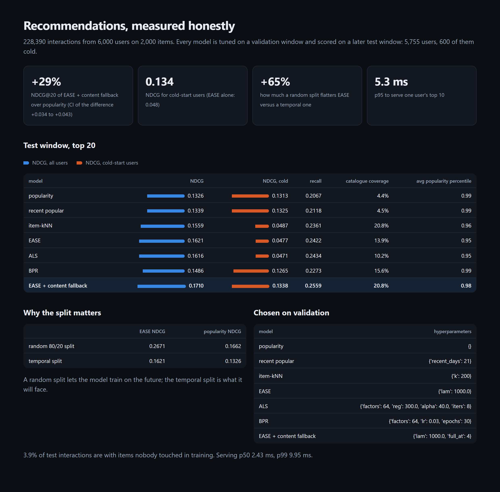

# Recommender System

Recommendations measured honestly. It compares implicit ALS, BPR, EASE and item-kNN against the
popularity baseline every model must beat. Each model is tuned on one time window and scored once on
a later one. Cold-start users get a content fallback, and the report covers catalogue coverage and
popularity bias. A small HTTP API serves one user's top 10 in about 5 ms at p95.

[](https://github.com/codeROCK-IZZY/recommender-system/actions/workflows/ci.yml)



## Results

From `recsys evaluate` (228,390 interactions, 6,000 users, 2,000 items; hyperparameters chosen on a
validation window, numbers from a later test window; [full report](eval/reports/evaluation.md)):

| model | NDCG@20 | recall@20 | NDCG, cold-start users | catalogue coverage |
|---|---:|---:|---:|---:|
| popularity | 0.133 | 0.207 | 0.131 | 4% |
| item-kNN | 0.156 | 0.236 | 0.049 | 21% |
| ALS (implicit) | 0.162 | 0.243 | 0.047 | 10% |
| EASE | 0.162 | 0.242 | 0.048 | 14% |
| BPR | 0.149 | 0.227 | 0.127 | 16% |
| **EASE + content fallback** | **0.171** | **0.256** | **0.134** | 21% |

- **+29% NDCG over popularity**, with a paired bootstrap 95% interval of +0.034 to +0.043 per user.
  Popularity is a hard baseline here, as it is in real shops.
- **Collaborative models fail on cold start:** on users with 3 or fewer interactions they score about
  a third of what popularity does. Blending in genre affinity and popularity, weighted by how much
  history a user has, restores it ([ADR 2](docs/adr/0002-content-fallback-for-cold-start.md)).
- **A random split flatters the model by 65%:** EASE scores 0.267 on a random 80/20 split and 0.162
  on the temporal split it will actually face ([ADR 1](docs/adr/0001-temporal-split-tuned-on-validation.md)).
- **Fair tuning changes conclusions.** ALS first looked worse than popularity (0.097). A wider grid
  on validation (more regularisation) put it level with EASE. Every grid and the chosen settings are
  in the report.
- 3.9% of test interactions are with items released after training, which no collaborative model can
  rank.

## How it works

- `data.py`: a synthetic shop with a long tail, users whose taste drifts across genres, items
  released during the period, late sign-ups and repeat views. Interactions are drawn from a softmax of
  taste match plus log popularity, independent of every model.
- `models.py`: popularity, recent popularity, item-kNN (cosine, top-k neighbours), EASE (closed-form
  linear autoencoder), ALS (implicit feedback with confidence weighting, exact alternating solves),
  BPR (pairwise ranking, mini-batch SGD), and the hybrid.
- `metrics.py`: temporal and random splits, top-K with already-seen items removed, recall and NDCG,
  paired bootstrap.
- `serve.py`: `Recommender.recommend(user, k)` and `similar(item, k)`, plus a FastAPI app:
  `GET /users/{id}/recommendations?k=10` and `GET /items/{id}/similar`. Unknown users get popular
  items.

## Run it

```bash
python -m venv .venv && . .venv/bin/activate
pip install -e ".[dev]"
pytest
recsys evaluate --gate          # ~6 min; writes eval/reports/{evaluation.md,evaluation.json,report.html}
recsys recommend 42             # top 10 for user 42
recsys serve                    # http://127.0.0.1:8090/users/42/recommendations
```

| check | where |
|---|---|
| 12 tests, strict mypy, ruff | `tests/`, `src/` |
| the evaluation as a CI gate (beats popularity with confidence, rescues cold start, wider coverage, p95 ≤ 25 ms) | `.github/workflows/ci.yml` |

See [known limitations](docs/known-limitations.md).

## License

MIT
